<!-- MOOM_DESIGN_hero_START -->
<p><picture><source media="(max-width: 600px)" srcset="assets/readme/hero-mobile.svg"/>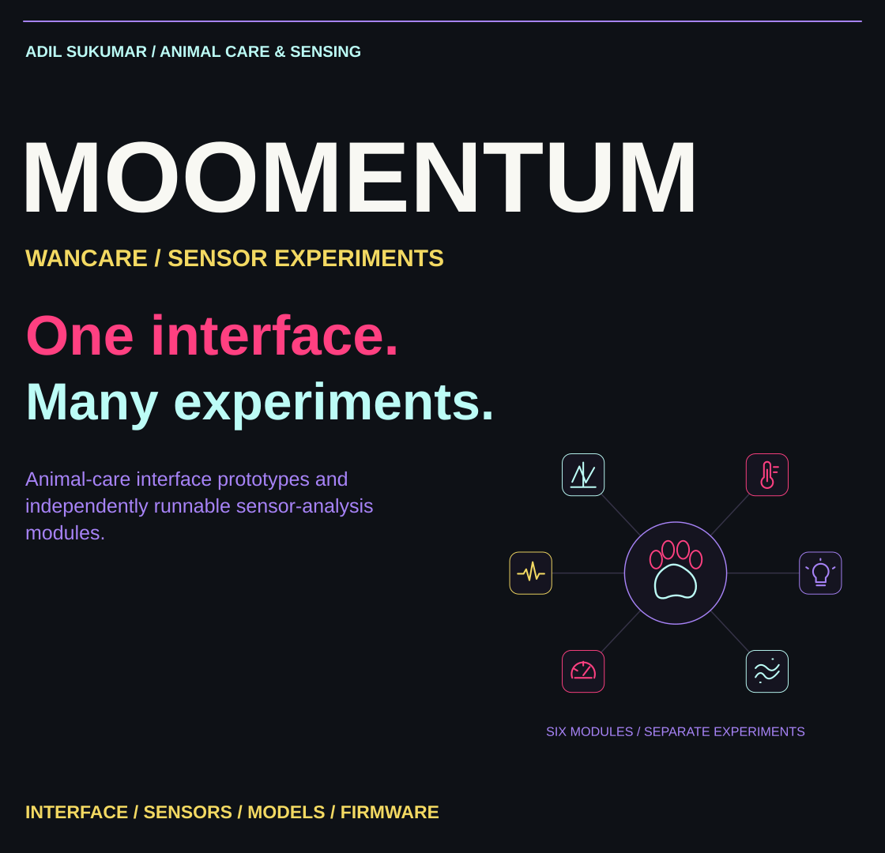</picture></p>
<!-- MOOM_DESIGN_hero_END -->

# Moomentum

Animal-care interface prototypes and independently runnable sensor-analysis modules. The web application contains the WanCare pet-care interface; the module folders preserve separate experiments, training pipelines and firmware integrations.

<!-- MOOM_DESIGN_modules_START -->
<p><picture><source media="(max-width: 600px)" srcset="assets/readme/section-modules-mobile.svg"/>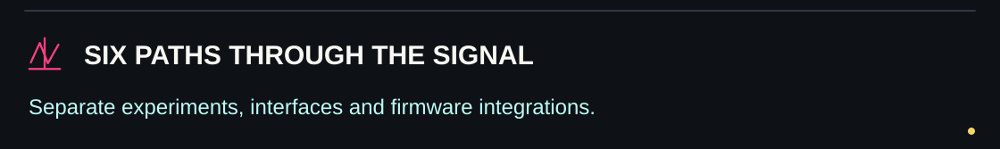</picture></p>

<p><picture><source media="(max-width: 600px)" srcset="assets/readme/modules-mobile.svg"/>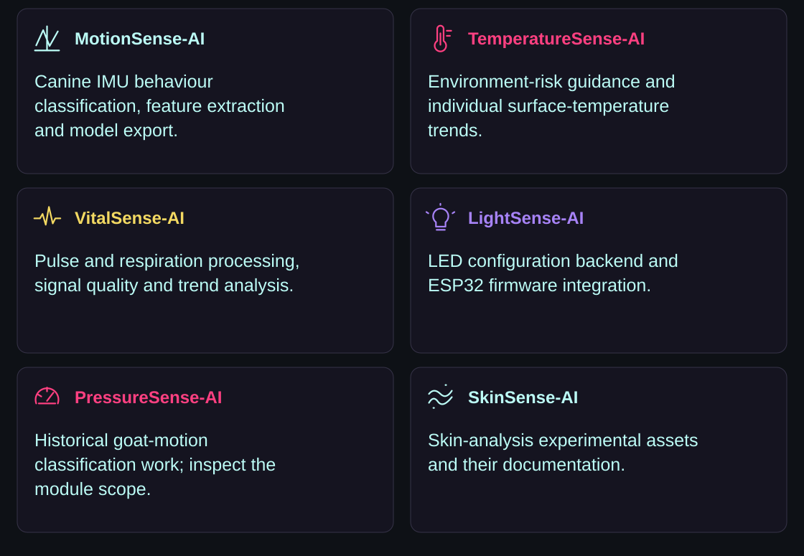</picture></p>
<!-- MOOM_DESIGN_modules_END -->

## Explore the modules

| Folder | Purpose | Evidence limit |
|---|---|---|
| `MotionSense-AI` | Canine IMU behaviour classification, feature extraction and model export | Behaviour labels and anomaly alerts do not establish disease diagnosis |
| `TemperatureSense-AI` | Environment-risk guidance and individual surface-temperature trends | Collar surface readings are not core temperature or a fever/rabies diagnosis |
| `VitalSense-AI` | Pulse/respiration processing, signal quality and trend analysis | Requires appropriate sensing and veterinary validation |
| `LightSense-AI` | LED configuration backend and ESP32 firmware | Hardware behaviour needs testing on the target board |
| `PressureSense-AI` | Historical folder containing goat-motion classification work | The folder name is not evidence of a validated barometric model |
| `SkinSense-AI` | Skin-analysis experimental assets | Inspect module assets and validation before making performance claims |

Read each module's documentation before interpreting its output. Sample/simulated interface data are not live animal measurements. Different species, sensor locations and datasets are not interchangeable.

<!-- MOOM_DESIGN_web_START -->
<p><picture><source media="(max-width: 600px)" srcset="assets/readme/section-web-mobile.svg"/>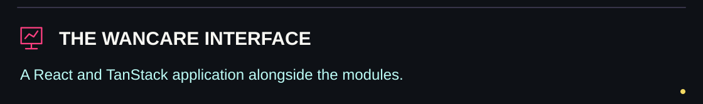</picture></p>

<p><picture><source media="(max-width: 600px)" srcset="assets/readme/architecture-mobile.svg"/>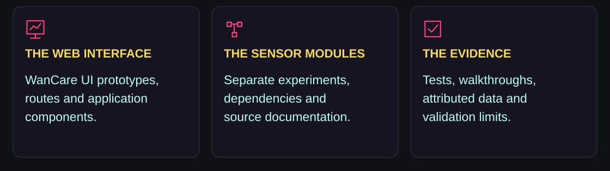</picture></p>
<!-- MOOM_DESIGN_web_END -->

## Web application

```sh
bun install --frozen-lockfile
npm run dev
npm run build
```

The interface uses React, TypeScript, TanStack Start and Tailwind CSS. Follow the package scripts and environment configuration for the selected deployment adapter. This is a prototype repository, not a production veterinary service.

<!-- MOOM_DESIGN_updates_START -->
<p><picture><source media="(max-width: 600px)" srcset="assets/readme/section-updates-mobile.svg"/>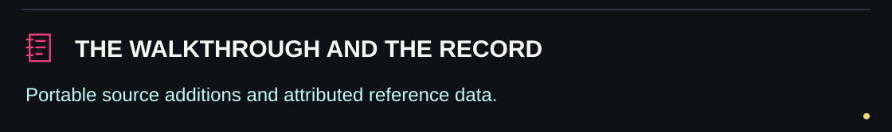</picture></p>

<p><picture><source media="(max-width: 600px)" srcset="assets/readme/updates-mobile.svg"/>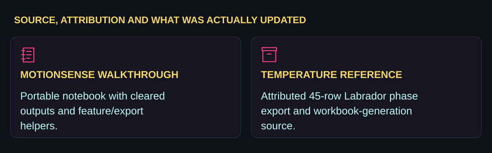</picture></p>
<!-- MOOM_DESIGN_updates_END -->

## Latest source update

- Added a portable MotionSense walkthrough notebook with outputs cleared, its generator and the current feature/export helpers.
- Added a 45-row Labrador temperature reference export, source attribution and a reproducible workbook-export script.
- Preserved the existing frontend, models and other module history. Large datasets, installed dependencies, temporary staging repositories, local databases and credentials are excluded from this update.

The temperature reference uses the [Neander et al. dataset](https://doi.org/10.17632/ykfvgt49gg.1), licensed CC BY 4.0. The derived table contains three phases for 15 usable dogs. It is a single-breed non-clinical reference and is not used to set fever/rabies thresholds. See [data attribution and limitations](TemperatureSense-AI/data/README.md).

<!-- MOOM_DESIGN_reproduce_START -->
<p><picture><source media="(max-width: 600px)" srcset="assets/readme/section-reproduce-mobile.svg"/>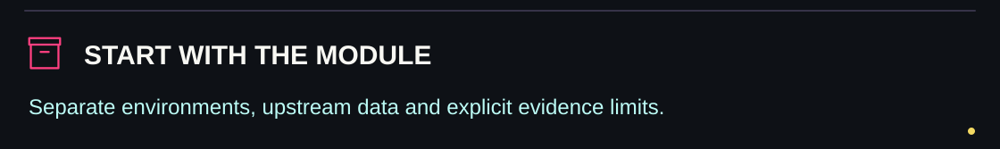</picture></p>

<p align="center"><a href="MotionSense-AI/PROJECT.md">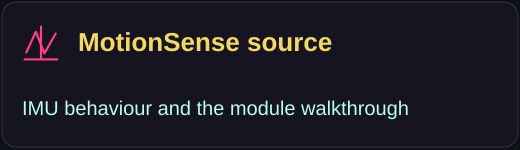</a> <a href="TemperatureSense-AI/README.md">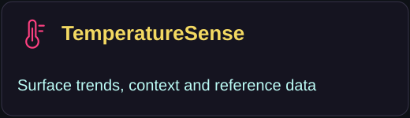</a> <a href="VitalSense-AI/README.md">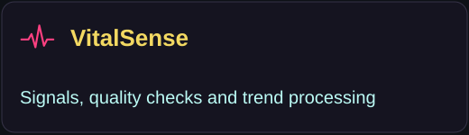</a> <a href="LightSense-AI/README.md">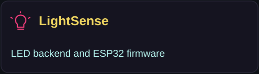</a> <a href="PressureSense-AI/README.md"></a> <a href="SkinSense-AI/PROJECT.md">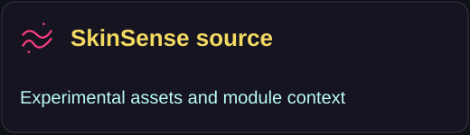</a></p>
<!-- MOOM_DESIGN_reproduce_END -->

## Reproducibility

Module dependencies are intentionally separate. Start with the corresponding README and requirements/pyproject file. MotionSense's large DogMove dataset is represented through Git LFS in the existing repository; obtain it and any required upstream data before training. The notebook is a walkthrough, not a claim that its cleared cells were executed in this source update. No model was retrained and no new accuracy claim is made here.

Maintained by Adil Sukumar. Preserve upstream dataset/model attribution and distinguish experiments from measured performance on deployed sensors.


<!-- MOOM_DESIGN_closing_START -->
<p><picture><source media="(max-width: 600px)" srcset="assets/readme/closing-mobile.svg"/>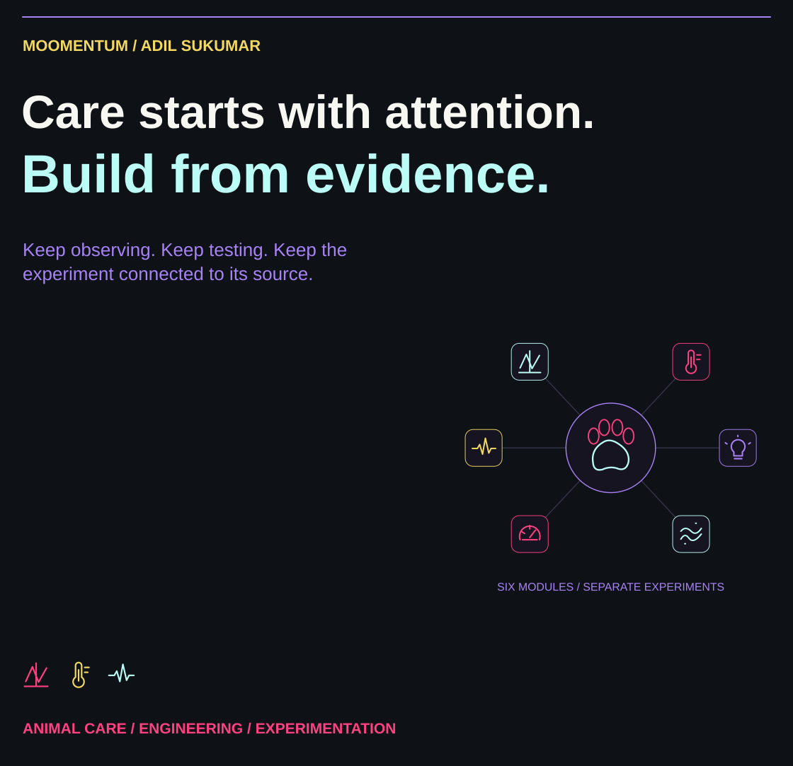</picture></p>
<!-- MOOM_DESIGN_closing_END -->
